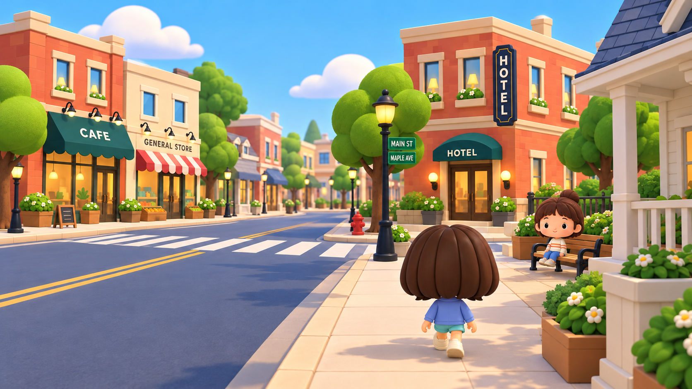
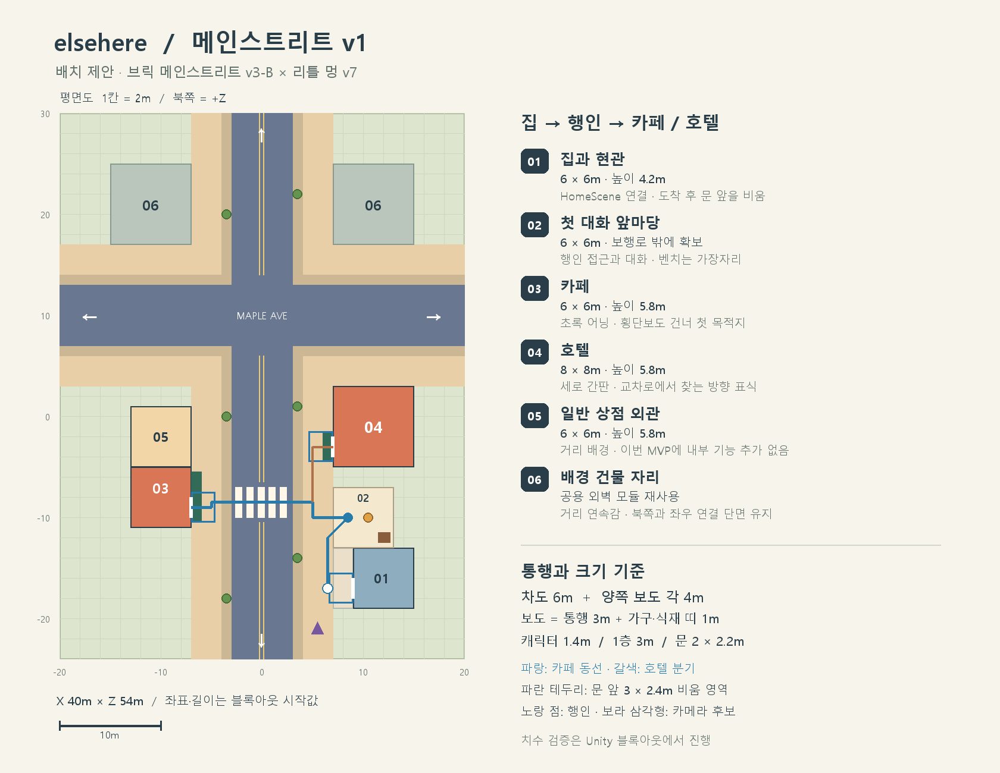

# Elsehere 메인스트리트 씬 디자인 v1

집 앞에서 행인을 만나고, 횡단보도 건너 카페나 같은 보도 끝의 호텔로 이동하는 마을 배치 제안이다. **브릭 메인스트리트 v3-B의 건축과 리틀 멍 v7의 비율**을 사용한다. 기존 미술 방향을 유지하고 건물은 확대안, 캐릭터는 확정 키 1.6m를 적용한다. 실제 아트 검토 씬은 `Assets/Scenes/Sandbox/TownMainstreetSandbox.unity`이며, 배포용 `TownScene` 적용은 별도 검증 대상이다.

이미지는 거리 분위기와 시선 구도를 보여주는 생성 콘셉트다. 평면도 이미지는 확대 전 기록이다. 현재 위치·치수는 아래 갱신된 표를 따른다. Production TownScene의 실제 화면과 이용 장소·닫힌 배경 건물 구분, 북동쪽 공원과 북쪽 확장 배치는 [Unity 아트 문서](../../../../unity/mainstreet-art.md)를 따른다.

## 1. 공간의 역할

첫 화면에서는 왼쪽의 초록 카페 어닝, 오른쪽의 세로 호텔 간판, 집 앞의 작은 대화 공간이 구분되어야 한다. 간판을 높이만 키워 강조하기보다 건물 모서리와 도로 방향으로 시선을 모은다. 집은 박공지붕과 포치로 상업 건물과 구별한다.

집에서 나온 사용자는 보행로 옆 앞마당에서 행인을 만난다. 행인이 먼저 접근하고 카페 위치를 묻는 [MVP 튜토리얼](../../../../A305_기획안/3D%20AI%20언어학습%20서비스%20—%20MVP%20기능%20범위.md)을 지원하는 자리다. 대화 위치에서 카페의 어닝과 횡단보도를 함께 볼 수 있게 한다. 이후 카페와 호텔로 갈 수 있으며, 그림에 있는 일반 상점은 배경 외관으로 둔다.

## 2. 배치와 크기

북쪽을 +Z, 동쪽을 +X로 둔다. 도면은 X=-20~20m, Z=-24~30m의 **40×54m** 범위다. 이는 이번 검토 구간이며 마을 전체 크기를 제한하지 않는다. 건물 크기는 [B안 제작 규격](../../village/production-v2/art-spec.md)을 따른다. 아래 좌표는 확대안의 건물 외곽과 지면상의 위치다. Sandbox는 북쪽 보도를 Z=70까지 연장한다.

| 도면 | 대상 | X 범위 | Z 범위 | 크기와 역할 |
| --- | --- | --- | --- | --- |
| 01 | 집 | 9~17 | -21~-13 | 8×8m, 높이 5.2m. 서쪽으로 출입. 전면 X=7~9에 포치 공간 |
| 02 | 첫 대화 앞마당 | 7~13 | -13~-7 | 6×6m. 보도와 같은 높이, 서쪽 보도에 열림 |
| 03 | 카페 | -15~-7 | -13~-5 | 8×8m, 높이 7.4m. 동쪽으로 출입, 초록 어닝 |
| 04 | 호텔 | 7~17 | -7~3 | 10×10m, 높이 7.4m. 서쪽으로 출입, 북쪽 교차로 모서리 |
| 05 | 일반 상점 외관 | -15~-7 | -5~3 | 8×8m, 높이 7.4m. 카페에 이어지는 배경 건물 |
| 06 | 북쪽 배경 건물 자리 | -15~-7 / 7~15 | 17~25 | 각 8×8m 부지. 기존 외벽 모듈로 연속된 거리 표현 |
| — | 메인 차도 | -3~3 | -24~30 | 폭 6m |
| — | 서쪽 / 동쪽 보도 | -7~-3 / 3~7 | -24~30 | 각각 폭 4m. 가구 띠 1m와 연속 통행 3m |
| — | 교차 차도 | -20~20 | 7~13 | 폭 6m. 남북 보도는 Z=3~7 / 13~17 |
| — | 첫 횡단보도 | -3~3 | -12.5~-9.5 | 카페와 앞마당을 연결하는 폭 3m 횡단 구간 |

보도와 앞마당, 건물 1층 바닥은 Y=0.1m, 차도는 Y=0이다. 횡단보도 양끝에 낮아지는 보도 연결부를 두어 이동 Collider가 걸리지 않게 한다. 출입문 앞에는 계단이나 문턱을 두지 않는다.

## 3. 출입과 대화 동선

| 지점 | X, Z 후보 좌표 | 배치 조건 |
| --- | --- | --- |
| 집 문 중심 | 9, -19 | 서쪽으로 열림. HomeScene과 연결 |
| 집 밖 도착점 | 4.8, -18.5 | Sandbox 시작점. 문 감지 영역 밖에서 시작하도록 최종 Trigger와 함께 조정 |
| 앞마당 사용자 자리 | 8.5, -10 | 연속 보행로를 벗어난 위치 |
| 행인 대화 자리 | 10.5, -10 | 사용자와 약 2m 간격부터 시험. 접근 시작점은 앞마당 안에서 별도 설정 |
| 카페 문 중심 | -7, -11 | 동쪽으로 열림. CafeScene과 연결 |
| 호텔 문 중심 | 7, -5 | 서쪽으로 열림. HotelScene과 연결 |

평면도의 파란 선은 집 밖 도착점에서 앞마당을 거쳐 카페로 가는 제안 경로다. 갈색 선은 동쪽 보도에서 호텔로 이어진다. 이 선을 필수 이동 순서나 자동 이동 기능으로 해석하지 않는다. 사용자는 기존 이동 방식으로 자유롭게 이동한다.

각 문 앞에는 전면을 따라 3m, 바깥 방향으로 2.4m의 비움 영역을 둔다. 카페는 X=-7~-4.6 / Z=-12.5~-9.5, 호텔은 X=4.6~7 / Z=-6.5~-3.5, 집은 X=6.6~9 / Z=-20.5~-17.5다. 화분, 대기 NPC, 간판 받침과 문 전환 직후 도착점을 서로 겹치지 않게 조정한다.

콘셉트 이미지의 벤치 NPC는 거리 분위기를 보여주는 배경 연출이다. 튜토리얼 행인은 기존 기획대로 사용자에게 걸어와 말을 거는 별도 배치로 연결한다. 이 이미지로 NPC 얼굴 프리셋이나 앉기 기능을 확정하지 않는다.

## 4. 캐릭터와 카메라

캐릭터는 [리틀 멍 v7의 현재 4방향 기준](../../mascot/little-mung-v7/README.md)을 사용한다. 전체 키는 1.6m로 확정하며 헤어 포함 머리 약 0.96m, 턱 아래 약 0.64m를 유지한다. 마을 이미지에 포함됐던 이전 캐릭터 비율로 바꾸지 않는다. 얼굴을 제작할 때도 B/Cluster의 모인 이목구비와 각 흰자 안에서 코 쪽에 조금 붙은 눈동자 위치를 유지한다.

| 항목 | 블록아웃 시작값 | 확인할 화면 |
| --- | --- | --- |
| 기본 카메라 | 피벗 2.5m, 눈높이 약 1.074m, 거리 6.2m, 아래쪽 각도 6도 | 낮게 내려다보며 건물과 하늘이 함께 보이는지 |
| 카메라 시야각 | 세로 55도 후보 | 가로 화면에서 양쪽 목적지를 읽을 수 있는지 |
| 출발 시선 | 집 앞 보도 (4.8,-18.5), 북쪽에서 동쪽으로 12도 | 가까운 포치 기둥과 머리가 화면 중앙을 막지 않는지 |
| 대화 시선 | 앞마당 안에서 사용자와 행인 사이 | 건물 문, 보행로, 다른 NPC와 충돌하지 않는지 |

이 값은 Mainstreet Sandbox 전용 설정이며 다른 플레이어·Production 카메라 설정은 바꾸지 않는다. 실제 눈높이는 v7 모델의 눈 중심에서 측정한다. 콘셉트 이미지의 구도를 카메라 수치가 검증된 화면으로 사용하지 않는다.

1층 4m, 2층 포함 총높이 7.4m, 문 유효 폭 2m·높이 2.2m를 유지한다. 어닝 최저점은 바닥에서 약 2.37m다. 캐릭터가 문에 들어가기 위해 커지거나 건물을 축소하지 않는다.

## 5. 미술과 장식

벽돌 코럴, 크림 창틀, 초록 어닝, 남색 호텔 간판으로 기존 마을의 색을 유지한다. 큰 상층 창 두 개와 넓은 벽 여백, 물결 끝단의 카페 차양, 곡선 호텔 차양, 따뜻한 진열창과 화단을 조합한다. 벽돌·도로·잎은 옅은 색 변화만 표현하고 사실적인 균열·오염은 생략한다. 낮 조명 하나와 하늘·수평·지면 환경광, 전용 Volume의 약한 bloom과 색 보정을 사용한다. 실제 Unity 설정은 [외관 아트 문서](../../../../unity/mainstreet-art.md)를 따른다.

나무와 가로등은 보도 바깥쪽 1m 띠에 드문드문 배치한다. 평면도의 초록 점은 식재 기준점이며 나무 수관의 실제 외곽이 아니다. 모델을 넣은 뒤 수관과 가로등이 간판·대화 얼굴·카메라를 가리지 않는지 검사한다. 벤치는 앞마당 가장자리로 옮기고 가운데에는 대화 공간을 남긴다.

## 6. 제작 범위와 확장

첫 제작 구간은 **집 출입구 → 앞마당 → 횡단보도 → 카페 한 동 → 호텔 외관**이다. 필요한 에셋은 집·카페·호텔 외관, 배경 상점 외관, 도로·보도·교차로·횡단보도, 문과 어닝, 두 종류 간판, 공용 나무·가로등·화분·벤치다. 기존 [에셋 목록](../../village/production-v2/asset-list.md)의 공용 모듈을 우선 사용한다.

북쪽과 교차로 좌우 끝에는 차도 6m와 양쪽 보도 4m의 동일 단면을 남긴다. 이후 블록을 붙일 자리를 건물로 막지 않는다. 현재 플레이 경계는 도로 연장부보다 안쪽에서 설정하고, 열린 길처럼 보이는 경계로 플레이어가 빠져나가지 않도록 블록아웃에서 확인한다. 북쪽 배경은 초기에는 외관만 만들고 내부 씬을 추가하지 않는다.

## 7. Unity에서 다음으로 확인할 것

1. 1.6m v7 비율 대체물과 확대 건물의 치수를 유지하고, 공통 외관·가로 시설 모듈을 조립한 Sandbox에서 집·카페·호텔을 오간다.
2. 기본·최소·최대 줌과 대화 화면에서 머리, 포치, 나무, 어닝의 가림을 확인한다. 문 앞 비움 영역과 보도 통행 폭을 유지한다.
3. 기존 HomeScene ↔ TownScene ↔ CafeScene / HotelScene 출입 연결과 행인 접근 흐름에 배치를 맞춘다. 문 Visual과 기능 Trigger는 구분한다.
4. 카페와 보도 한 구간의 크기·재질을 확인한 뒤 나머지 외관으로 확장한다. 세부 순서는 [Unity 적용 계획](../../village/production-v2/unity-application-plan.md)을 따른다.

## 산출물

- [거리 콘셉트 PNG](../../../../../artifacts/scenes/elsehere/mainstreet-v1/street-view.png): 내장 이미지 생성 도구 사용.
- [치수 평면도 PNG](../../../../../artifacts/scenes/elsehere/mainstreet-v1/layout-plan.png): 좌표 기반 도식.
- [이미지 생성 프롬프트](street-view-prompt.txt): 사용한 참조 이미지의 역할과 생성 조건.
- [평면도 생성 소스](../../../../../artifacts/scenes/elsehere/mainstreet-v1/render-layout.py): 좌표·라벨 수정 후 같은 폴더에 다시 렌더.
