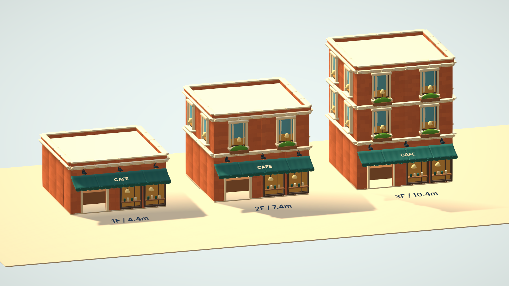

# Blender 카페 모듈 사용 방법

카페 한 동과 앞 보도에 사용하는 부품 세트다. 벽·창·차양을 각각 수정하고, 공통 층을 쌓아 건물 높이를 바꾼다. 미국 소도시의 코럴 벽돌, 크림 창틀, 초록 천 차양과 둥근 식재를 사용한다.



[거리 속 카페](../../artifacts/unity/mainstreet-blockout/09-art-cafe.png)와 위 이미지는 Unity 카메라 렌더다. 리틀 멍 v7 캐릭터는 높이 1.6m·머리 60%·몸 40%를 확인하는 대체물이며 완성 캐릭터 모델은 아니다.

## 파일과 조립 구조

| 위치 | 내용 |
| --- | --- |
| `frontend/ArtSources/World/CafeKit/CafeKit.blend` | 부품별 Collection과 수정 가능한 메시·커브·모디파이어 |
| `frontend/ArtSources/World/CafeKit/build_cafe_kit.py` | 초기 부품 생성과 편집 원본 FBX 내보내기 |
| `Assets/Art/World/CafeBlenderKit/Models/` | FBX 15개와 실제 치수·삼각형 수를 담은 manifest.json |
| `Assets/Art/World/CafeBlenderKit/Materials/` | 공용 URP 머티리얼 16개 |
| `Assets/Prefabs/World/CafeBlenderKit/Parts/` | FBX를 참조하는 부품 프리팹 15개 |
| `Assets/Prefabs/World/CafeBlenderKit/Floors/` | GroundFloor8m, UpperFloor8m, Roof8m |
| `Assets/Prefabs/World/CafeBlenderKit/Buildings/` | Cafe1F, Cafe2F, Cafe3F |
| `Assets/Scripts/Editor/World/MainstreetCafeKitBuilder.cs` | 가져오기 설정, 조립, Sandbox 적용과 프리팹 검수 |

`Assets/` 경로는 `frontend/UnityClient/` 기준이다. .blend는 Unity 자동 변환에 의존하지 않도록 Assets 밖에 둔다. 건물 → 층 → 부품 → FBX의 중첩 프리팹 연결을 유지하며, 각각의 메시와 재질을 공유한다.

## 치수와 원점

Unity 1 unit은 1m다. 루트 Scale은 (1, 1, 1), 위쪽은 +Y, 전면은 +Z다. 건물·층 원점은 전면 중앙의 바닥이며, 내부는 Z=-8m까지 이어진다. 벽 부품은 폭 중심 X=0, 바닥 Y=0, 전면 Z=0에 맞춘다. 창·차양은 부착 위치를 기준으로 하고, 실제 경계 크기는 manifest를 따른다.

| 부품 | 규격·용도 |
| --- | --- |
| WallGround2m / WallUpper2m | 폭 2m, 높이 4m / 3m, 두께 0.22m |
| Entrance4m | 폭 4m·높이 4m 벽, 중앙 출입구 유효 폭 2m·높이 2.2m |
| Cornice2m / RoofEdge2m | 폭 2m 띠장 / 높이 0.4m 옥상 가장자리 |
| WindowUpper2m / WindowShop2m | 폭 2m 벽 구간용 상층 창 / 1층 진열창 |
| Awning2m | 폭 2m 연결 기준, 깊이 약 1.43m. 끝단 두께 때문에 실제 폭은 약 2.023m |
| FlowerPlanter1m / WindowBox1p6m | 보도 화분 / 창 아래 화분 |
| GardenTree4m | 높이 약 4.46m, 수관 연결부를 합친 메시 |
| CafeTable / CafeChair | 상판 약 0.625m / 좌판 약 0.28m. 앉기 애니메이션은 미검증 |
| WallLamp / Paving2m | 곡선 벽등 / 2m 배치 간격의 보도 타일 |

벽·문·바닥은 BoxCollider를 사용한다. 문 개구부에는 Collider를 두지 않는다. 나무는 줄기, 보도 화분은 용기에만 단순 Collider를 둔다. 창은 불투명한 진열 면이고, 실내는 임시 카운터 배경이다. 상층 실내·계단·지붕 보행은 포함하지 않는다.

## 층수와 건물 늘리기

| 건물 | 1층 Y | 상층 Y | 지붕 Y | 전체 높이 |
| --- | --- | --- | --- | --- |
| Cafe1F | 0 | 없음 | 4 | 4.4m |
| Cafe2F | 0 | 4 | 7 | 7.4m |
| Cafe3F | 0 | 4, 7 | 10 | 10.4m |

새 건물은 Buildings의 예시를 배치하거나 Prefab Variant로 만들고, 상호·색·창 구성을 바꾼다. 층수를 바꾸려면 상층 프리팹을 3m 간격으로 추가·제거하고 지붕을 그 위로 옮긴다. 건물 전체 Scale로 높이를 늘리지 않는다.

폭·깊이를 바꿀 때는 층 프리팹의 별도 변형을 만들어 2m 벽·띠장·차양을 추가한다. 창 배치, 모서리, 바닥과 지붕 판의 크기, Collider를 함께 맞춘다. 현재 예시는 8×8m이며 임의 폭을 자동 조립하는 기능은 없다. 층과 부품을 Unpack하면 공통 변경을 받을 수 없으므로 중첩 연결을 유지한다.

문 앞 폭 3m·깊이 2.4m를 비워 캐릭터와 카메라가 접근할 공간을 확보한다. 카페 기준 문 중심은 로컬 X=2m다. 새 건물을 씬에 추가할 때는 보도·이웃 건물·경계와의 간섭을 다시 확인한다.

## Blender에서 수정하고 Unity에 반영하기

Blender 5.2 LTS에서 원본을 열고 해당 Collection 안의 형상을 수정한다. 각 Collection의 `unity_export_offset`은 보기 편하게 펼쳐 둔 부품을 원래 내보내기 원점으로 되돌리는 값이다. 부품 트레이를 통째로 옮기거나 이 값을 임의로 바꾸지 않는다. 색상은 Unity의 공용 머티리얼에서 조정한다.

저장소 최상위에서 다음 명령으로 **저장한 원본의 편집 결과**를 내보낸다. Blender 실행 파일 경로는 설치 위치에 맞춘다.

```powershell
& "C:/Program Files/Blender Foundation/Blender 5.2/blender.exe" --background --factory-startup --python-exit-code 1 --python frontend/ArtSources/World/CafeKit/build_cafe_kit.py -- --source frontend/ArtSources/World/CafeKit/CafeKit.blend --output frontend/UnityClient/Assets/Art/World/CafeBlenderKit/Models --export-edited --replace-generated
```

이 명령은 .blend를 다시 생성하지 않고 FBX와 manifest만 갱신한다. 원본을 저장한 뒤 실행하고, 같은 파일명과 Unity .meta를 유지한다. FBX 변경은 이를 참조하는 부품·층·건물에 전달된다. Collection 이름과 재질 이름은 유지한다. 새 부품 종류를 추가하려면 가져오기·조립 코드도 함께 반영한다.

`--export-edited` 없이 실행하면 초기 형상을 다시 만드는 경로다. 기존 파일이 있으면 기본적으로 중단하며, `--replace-generated`를 함께 쓰면 편집 원본까지 덮어쓸 수 있으므로 새 버전을 만들 때만 의도적으로 사용한다.

Unity에서 **Tools → A305 → World → Build And Verify Blender Cafe**를 실행한다. 이 메뉴는 없는 프리팹·재질만 만들고, 이미 저장한 디자인은 유지한다. Sandbox는 다시 조립되므로 씬에서 바꾼 배치를 유지하려면 Builder에도 반영한다. 열려 있는 Editor에서는 메뉴를 사용하며 같은 프로젝트를 batchmode로 동시에 열지 않는다.

현재 Sandbox는 8m 평면·1층 4m·상층 3m 조건에서 Cafe2F를 적용한다. 다른 치수를 설정하면 경고와 함께 기존 외관을 사용한다. 일반 상점·호텔·주택은 기존 MainstreetArt 부품을 유지한다.

## 검수와 성능 범위

카페 메뉴는 FBX 15개의 Unity 치수, 1·2·3층 높이와 중첩 층 연결을 확인한다. 이어서 Play에서 1.6m 캐릭터, 집·카페·호텔 문 통과, 북쪽 보도 39m 이동을 검사한다. 결과와 실제 카메라 이미지는 `artifacts/unity/mainstreet-blockout/`에 저장한다.

`cafe-prefabs.txt`에는 다음 메시 수치가 기록된다. 건물 자체 기준이며 보도·나무·보도 화분·가구는 제외한다.

| 예시 | 삼각형 수 | Mesh Renderer 수 |
| --- | --- | --- |
| Cafe1F | 25,324 | 99 |
| Cafe2F | 47,848 | 177 |
| Cafe3F | 70,372 | 255 |

부품을 수정하기 쉬운 조립 원본이다. 여러 건물을 배치할 Web 버전은 Renderer 수, 드로 콜과 프레임 시간을 측정한 뒤 LOD·재질 묶기·정적 배칭 등을 선택해야 한다. 현재 수치만으로 Web 성능이나 목표 프레임을 보장하지 않는다.

이 작업은 모델링과 Scene·Prefab 배치에 해당하므로 단위 테스트 대신 실제 가져오기, 프리팹 참조 검사, Play 통행과 화면 검수를 사용한다. Blender 편집 원본의 재수출 치수도 확인한다. 캐릭터 완성 메시·리그·립싱크, 실내 기능, Production 연결은 별도 범위다. 카페 세트 제작에는 Tripo 생성 크레딧이나 추가 유료 에셋을 사용하지 않는다.

