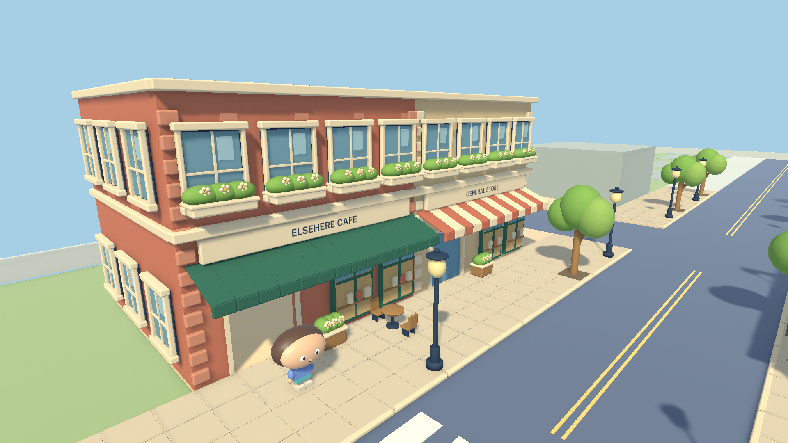

# 메인스트리트 외관 아트

`Assets/Scenes/Sandbox/TownMainstreetSandbox.unity`에서 미국 소도시의 벽돌 상점과 주택을 단순한 3D 게임 형태로 조립한다. 캐릭터 전체 키는 **1.6m로 확정**한다. 리틀 멍 v7의 머리 60%·몸 40%를 유지하며, 현재 캐릭터는 완성 모델이 아닌 비율 확인용 대체물이다.

위 이미지는 생성 콘셉트가 아닌 Unity 카메라의 실제 렌더다. [거리 전체](../../artifacts/unity/mainstreet-blockout/08-art-street.png), [플레이 시작 화면](../../artifacts/unity/mainstreet-blockout/01-start-view.png), [치수·검수 방법](mainstreet-sandbox.md)도 참고한다.

## 공통 규격

| 대상 | 기준 |
| --- | --- |
| 캐릭터 | 높이 1.6m, 머리 약 0.96m·몸 약 0.64m, 검수용 최대 헤어 폭 1.6m |
| 카페·상점 | 각각 8×8m, 높이 7.4m |
| 호텔 | 10×10m, 높이 7.4m |
| 집 | 8×8m, 벽 높이 4m + 박공지붕 1.2m |
| 문 / 비움 영역 | 유효 폭 2m·높이 2.2m / 전면 3×2.4m |
| 카메라 | 거리 4m, 피벗 약 1.029m, 눈높이 약 1.074m, pitch 25°, 세로 FOV 55° |
| 확장 | 6m 차도 + 양쪽 4m 보도, 북쪽 보행 구간 40m 추가 |

기존 벽·바닥·문 개구부의 Collider를 유지하고 장식 외관을 덧붙인다. 창은 불투명한 유리·진열 면으로 표현하며 창 전체를 투명 재질로 만들지 않는다. 일반 상점은 닫힌 배경 외관이다. 나머지 건물 내부의 카운터는 입구 너머 빈 화면을 줄이는 임시 배경이며 실내 기능 완성을 의미하지 않는다.

## 재사용 모듈

`Assets/Prefabs/World/MainstreetArt/`의 공통 프리팹을 복제 배치한다. 같은 부품의 내부 메시를 재질별로 묶고, 메시·머티리얼을 공유한다. 치수에 따라 달라지는 차양·띠장·지붕은 Builder가 조립한다.

| 모듈 | 조합 방식 |
| --- | --- |
| UpperWindow | 폭 약 1.7m·높이 약 2m. 상층·측면·주택 공용 |
| ShopWindow | 폭 1.7m·높이 2.45m. 따뜻한 진열 면·프레임·선반 공용 |
| WindowFlowerBox / FlowerPlanter | 창 아래 화단 / 보도 화분. 같은 잎·꽃 메시 사용 |
| BrickAccentPanel | 벽돌 전체를 쌓지 않고 일부 돌출 면으로 벽돌 느낌 표현 |
| RoundTree | 수관 세 덩어리, 약 3.85m. 몸통 Collider만 사용 |
| StreetLamp | 약 3.4m. 실시간 Point Light 없이 밝은 유리 재질 사용 |
| ParkBench / CafeTable | 좌판 약 0.27~0.29m, 작은 몸 비율에 맞춘 가구. 앉기 동작은 미검증 |
| PicketFence2m | 주택 앞마당 가장자리에 연결 |
| SidewalkTile2m | 2×2m 보도 반복. 교차로 끝은 길이를 절반으로 조정 |
| FireHydrant | 빨간 소화전 한 종류 재사용 |
| KenneyDeliveryTruck | CC0 모델 한 개를 길이 3.8m의 장식 차량으로 배치 |

카페는 코럴 벽·초록 차양, 상점은 버터색 벽·크림/코럴 줄무늬 차양, 호텔은 코럴 벽·남색 세로 간판, 집은 청회색 외벽·박공지붕·포치로 구분한다. 노출 모서리는 둥글리고 실제 벽돌·나무·직물의 미세 질감은 생략한다.

| 재질 | sRGB HEX |
| --- | --- |
| CoralBrick / ButterStucco | #CC795E / #E6C998 |
| WarmCream / DeepGreen | #F2DFBA / #326B57 |
| SignNavy / HomeBlue | #293E57 / #89A9B3 |
| LeafGreen / HoneyWood | #7FAD50 / #A77C4C |
| WindowBlue / SandPaving | #739FAF / #D8C9AD |

새 머티리얼은 URP/Lit, Metallic 0, Smoothness 0.18로 시작한다. 조명은 Directional Light 하나와 환경광을 사용한다. 이 수치는 이미지에서 측정한 물성값이 아닌 Unity 아트 시작값이다.

## 제작과 변경

1. `TownBlockoutSettings`에서 건물·캐릭터 치수를 확인한다. 기준 키는 1.6m다.
2. `MainstreetArtKit`은 메시·재질·장식 프리팹을 없을 때만 생성한다. 이미 디자인한 프리팹이나 머티리얼을 재실행으로 덮어쓰지 않는다.
3. `MainstreetArtBuilder`에서 모듈의 배치·색 조합을 조절한다. `TownMainstreetBuilder`가 기본 건물에 아트를 붙인다.
4. **Tools → A305 → World → Build Mainstreet Sandbox**로 씬을 재생성한다. 씬에서 직접 움직인 위치는 사라지므로 유지할 배치는 Builder에 반영한다.
5. **Verify Mainstreet Sandbox**로 Play 검수와 실제 카메라 캡처를 실행한다. 새 아트 시점은 `08-art-street.png`, `09-art-cafe.png`다.

원형 프리팹의 생김새를 바꿀 때는 Inspector에서 해당 프리팹을 수정한다. Builder 코드만 바꿔도 이미 만들어진 프리팹이 자동 교체되는 구조가 아니다. 구조 변경은 별도 이름의 모듈로 시험한 뒤 사용처를 변경한다. 늘어나는 건물은 이미 있는 창·화단·차양·가로 시설을 우선 조합한다.

## 외부 에셋과 Tripo

도입한 외부 에셋은 [Kenney Car Kit 3.1](https://kenney.nl/assets/car-kit)의 `truck-flat.fbx` 한 개와 `colormap.png`다. 공식 라이선스는 **CC0**이며 원본 `License.txt`와 함께 `Assets/ThirdParty/KenneyCarKit/`에 둔다. 원본 파일을 보존하고 팀용 프리팹에서 크기·URP 머티리얼·Collider를 연결한다. 차량 주행 기능은 포함하지 않는다.

건물 전체나 규격 벽·창문을 Tripo로 반복 생성하지 않는다. 이 모듈들은 Unity에서 치수와 재질을 조절할 수 있어 이번 외관 제작에 **Tripo 생성 크레딧은 0**이다. 추가 계정 연결이나 유료 패키지 없이 현재 씬을 열 수 있다.

이후 조형이 복잡한 공통 랜드마크 소품이 필요하면 대표 모델 하나만 후보로 정한다. 이미지·목표 폴리곤·출력 형식을 먼저 고정하고 CLI 설치·로그인 상태와 dry-run 비용을 확인한 다음 승인된 한 건만 생성한다. Unity에서 크기·재질·Collider를 검사한 뒤 색상·배치 변형으로 재사용한다. 캐릭터 전체를 NPC별로 새로 생성하는 방식은 사용하지 않는다.

## 적용 범위

현재 범위는 Sandbox 외관 아트와 크기·통행·카메라 검토다. 북쪽 추가 건물은 부지와 블록아웃으로 남아 있다. 실제 v7 메시·리그·립싱크, 실내 완성, Production 씬 전환 연결, Web 성능 측정은 별도 작업이다. 공유 메시와 프리팹 사용만으로 Web 성능을 검증했다고 판단하지 않는다. Web 적용 전에 꽃·창문 반복 수, Renderer·재질 수와 프레임 시간을 측정해 단순화한다.
