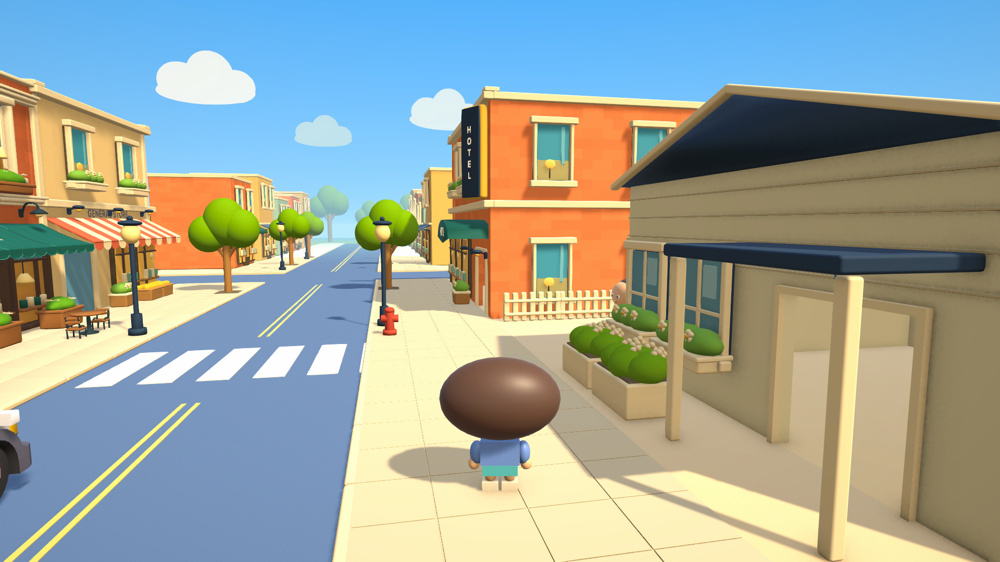

# 메인스트리트 외관 아트

`Assets/Scenes/Sandbox/TownMainstreetSandbox.unity`에서 미국 소도시의 벽돌 상점과 주택을 단순한 3D 게임 형태로 조립한다. 캐릭터 전체 키는 **1.6m로 확정**한다. 리틀 멍 v7의 머리 60%·몸 40%를 유지하며, 현재 캐릭터는 완성 모델이 아닌 비율 확인용 대체물이다.

위 이미지는 생성 콘셉트가 아닌 Unity 카메라의 실제 렌더다. [카페 외관](../../artifacts/unity/mainstreet-blockout/09-art-cafe.png), [거리 전체](../../artifacts/unity/mainstreet-blockout/08-art-street.png), [치수·검수 방법](mainstreet-sandbox.md)도 참고한다. 목표는 따뜻한 낮의 작은 미국 마을이다. 낮게 내려다보는 거리 구도, 코럴 벽과 넓은 창 사이 여백, 초록 천 차양, 따뜻한 진열창, 풍성한 식재와 연속된 상점 외관으로 표현한다.

## 공통 규격

| 대상 | 기준 |
| --- | --- |
| 캐릭터 | 높이 1.6m, 머리 약 0.96m·몸 약 0.64m, 검수용 최대 헤어 폭 1.6m |
| 카페·상점 | 각각 8×8m, 높이 7.4m |
| 호텔 | 10×10m, 높이 7.4m |
| 집 | 8×8m, 벽 높이 4m + 박공지붕 1.2m |
| 문 / 비움 영역 | 유효 폭 2m·높이 2.2m / 전면 3×2.4m |
| 카메라 | 거리 6.2m, 피벗 2.5m, 눈높이 약 1.074m, pitch 6°, 세로 FOV 55° |
| 확장 | 6m 차도 + 양쪽 4m 보도, 북쪽 보행 구간 40m 추가 |

카페는 [Blender 카페 모듈](cafe-blender-kit.md)의 공통 1층·상층·지붕 프리팹으로 조립한다. 나머지 건물은 기존 벽·바닥·문 개구부의 Collider를 유지하고 장식 외관을 덧붙인다. 창은 불투명한 유리·진열 면으로 표현하며 창 전체를 투명 재질로 만들지 않는다. 일반 상점은 닫힌 배경 외관이다. 건물 내부의 카운터는 입구 너머 빈 화면을 줄이는 임시 배경이며 실내 기능 완성을 의미하지 않는다.

## 재사용 모듈

카페의 신규 부품 15종, 1층·반복 상층·지붕과 1·2·3층 예시는 `Assets/Prefabs/World/CafeBlenderKit/`에 별도로 둔다. [층수 변경과 Blender 편집 방법](cafe-blender-kit.md)을 따른다. 아래 MainstreetArt 모듈은 나머지 건물과 거리에서 계속 사용한다.

`Assets/Prefabs/World/MainstreetArt/`의 공통 프리팹을 복제 배치한다. 같은 부품의 내부 메시를 재질별로 묶고, 메시·머티리얼을 공유한다. 치수에 따라 달라지는 차양·띠장·지붕은 Builder가 조립한다.

| 모듈 | 조합 방식 |
| --- | --- |
| TallWindowV2 | 폭 1.62m·높이 약 2.28m. 상점 상층·측면 공용. 전면은 큰 창 두 개와 넓은 벽 여백 |
| WarmShopWindowV2 | 폭 1.85m·높이 2.5m. 따뜻한 진열 면·선반·펜던트 조명 |
| GreenAwningStripV2 / StripedAwningStripV2 | 폭 0.55m 단위의 경사진 천과 물결 끝단. 카페 글자는 차양 면에 배치 |
| HotelArchV2 | 호텔의 곡선 차양 메시. 남색 세로 간판은 가까운 모서리에 배치 |
| WindowFlowerBox / FlowerPlanter | 창 아래 화단 / 보도 화분. 같은 잎·꽃 메시 사용 |
| GardenTreeV2 / GardenBedV2 | 약 4.35m 나무 / 0.95×1.5m 화단. 큰 수관과 꽃을 반복 조합, 나무 몸통 Collider 사용 |
| StreetLampV2 | 약 3.4m. 실시간 Point Light 없이 발광 재질 사용 |
| MarketCrateV2 / ChalkboardV2 | 상점 진열 상자 / 카페 입간판. 문 앞 비움 영역 밖에 배치 |
| DistantShopV2 3종 | 폭 6m·깊이 5.2m, 높이 5.8~7.3m의 닫힌 배경 외관. 북쪽 확장부에 배치 |
| ParkBench / CafeTable | 좌판 약 0.27~0.29m, 작은 몸 비율에 맞춘 가구. 앉기 동작은 미검증 |
| PicketFence2m | 주택 앞마당 가장자리에 연결 |
| SidewalkTile2m | 2×2m 보도 반복. 교차로 끝은 길이를 절반으로 조정 |
| FireHydrant | 빨간 소화전 한 종류 재사용 |
| KenneyDeliveryTruck | CC0 모델 한 개를 길이 3.8m의 장식 차량으로 배치 |

카페는 코럴 벽·초록 차양, 상점은 버터색 벽·크림/코럴 줄무늬 차양, 호텔은 코럴 벽·남색 세로 간판, 집은 크림 외벽·남색 박공지붕·포치로 구분한다. 노출 모서리는 둥글린다. 벽돌은 개별 메시를 쌓지 않고 월드 좌표의 옅은 색 변화로 표현하며, 사실적인 균열·오염·직물 질감은 생략한다. 주택의 기존 UpperWindow와 공용 화분 등은 계속 재사용한다.

| 재질 | sRGB HEX |
| --- | --- |
| CoralMasonry / ButterStuccoV2 | #E58B63 / #F0D29C |
| WarmCream / DeepGreen | #F2DFBA / #326B57 |
| SignNavy / HomeCreamV2 | #293E57 / #E8DFBF |
| GardenGreen / HoneyWood | #79A331 / #A77C4C |
| SkyGlassV2 / SandPaving | #4F9EB4 / #D8C9AD |
| RoadBlueV2 / WindowAmberGlow | #667FA7 / #FFCE76 |

일반 머티리얼은 URP/Lit, Metallic 0, Smoothness 0.18로 시작한다. 벽돌·수관·도로는 `Elsehere/SoftMasonry`의 확산광·그림자·환경광·안개를 사용한다. 셰이더의 색·그림자·깊이 패스는 같은 머티리얼 상수 버퍼를 공유한다. 구름은 Unlit, 하늘은 `Elsehere/SummerSky` 그라데이션으로 표현한다.

조명은 Directional Light 하나(회전 48°, -35°, 0°; 강도 1.7)와 하늘·수평·지면의 환경광을 사용한다. Sandbox 전용 Volume은 exposure 0, contrast 10, saturation 8, bloom 0.15, tonemapping None이다. 선형 안개는 42~125m이며 피사계심도는 사용하지 않는다. 이 수치는 이미지에서 측정한 물성값이나 Web 성능 검증값이 아닌 Unity 아트 시작값이다.

## 제작과 변경

1. `TownBlockoutSettings`에서 건물·캐릭터 치수를 확인한다. 기준 키는 1.6m다.
2. `MainstreetArtKit`은 메시·재질·장식 프리팹을 없을 때만 생성한다. 이미 디자인한 프리팹이나 머티리얼을 재실행으로 덮어쓰지 않는다.
3. `MainstreetArtBuilder`가 주요 건물, `MainstreetStreetDressing`이 원경 외관과 정원, `MainstreetAtmosphere`가 조명·하늘·후처리를 조립한다. `MainstreetReferenceKit`은 새 외관 공통 부품을 제공한다.
4. **Tools → A305 → World → Build And Verify Reference Look**은 전용 카메라 거리·피벗·각도와 색 보정을 위 값으로 적용하고 씬을 재생성한다. 기존 수치를 유지하려면 **Build Mainstreet Sandbox**를 사용한다. 씬에서 직접 움직인 위치는 사라지므로 유지할 배치는 Builder에 반영한다.
5. **Verify Mainstreet Sandbox**로 Play 검수와 실제 카메라 캡처를 실행한다. 새 아트 시점은 `08-art-street.png`, `09-art-cafe.png`다.

원형 프리팹의 생김새를 바꿀 때는 Inspector에서 해당 프리팹을 수정한다. Builder 코드만 바꿔도 이미 만들어진 프리팹이 자동 교체되는 구조가 아니다. 구조 변경은 별도 이름의 모듈로 시험한 뒤 사용처를 변경한다. 늘어나는 건물은 이미 있는 창·화단·차양·가로 시설을 우선 조합한다.

## 외부 에셋과 Tripo

도입한 외부 에셋은 [Kenney Car Kit 3.1](https://kenney.nl/assets/car-kit)의 `truck-flat.fbx` 한 개와 `colormap.png`다. 공식 라이선스는 **CC0**이며 원본 `License.txt`와 함께 `Assets/ThirdParty/KenneyCarKit/`에 둔다. 원본 파일을 보존하고 팀용 프리팹에서 크기·URP 머티리얼·Collider를 연결한다. 차량 주행 기능은 포함하지 않는다.

건물 전체나 규격 벽·창문을 Tripo로 반복 생성하지 않는다. 이 모듈들은 Unity에서 치수와 재질을 조절할 수 있어 이번 외관 제작에 **Tripo 생성 크레딧은 0**이다. 추가 계정 연결이나 유료 패키지 없이 현재 씬을 열 수 있다.

이후 조형이 복잡한 공통 랜드마크 소품이 필요하면 대표 모델 하나만 후보로 정한다. 이미지·목표 폴리곤·출력 형식을 먼저 고정하고 CLI 설치·로그인 상태와 dry-run 비용을 확인한 다음 승인된 한 건만 생성한다. Unity에서 크기·재질·Collider를 검사한 뒤 색상·배치 변형으로 재사용한다. 캐릭터 전체를 NPC별로 새로 생성하는 방식은 사용하지 않는다.

## 적용 범위

현재 범위는 Sandbox 외관 아트와 크기·통행·카메라 검토다. 북쪽 추가 건물은 재사용한 닫힌 배경 외관이며 기능이나 실내는 없다. 부지 마커와 임시 경계 벽은 아트 화면에서 숨기고 경계 Collider는 유지한다. 실제 v7 메시·리그·립싱크, 실내 완성, Production 씬 전환 연결, Web 성능 측정은 별도 작업이다. 공유 메시와 프리팹 사용만으로 Web 성능을 검증했다고 판단하지 않는다. Web 적용 전에 꽃·창문 반복 수, Renderer·재질 수와 프레임 시간을 측정해 단순화한다.
